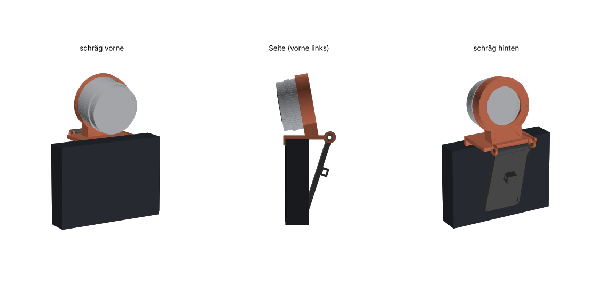

# Monitorhalterung für den M5Stack Dial (Lenovo ThinkVision P27h-10)



Die Halterung setzt das Dial wie eine Webcam auf die Oberkante des Monitors.
- **Basis:** liegt auf der Oberkante. Eine Lippe greift vorne über den Rahmen. Eine Manschette hält das Dial senkrecht, um 10° zum Betrachter geneigt.
- **Bein:** hängt hinten am Monitor herunter. Das Gelenk wird mit einer M4-Schraube festgezogen und klemmt damit jede Gehäusedicke. Die genaue Dicke der Oberkante muss man nicht kennen.

Die Manschette umfasst nur das feste Gehäuse auf den hinteren 10 mm, der **Drehring bleibt frei**. Beim Drücken stützt sich das Dial hinten an einer Anlage ab. Die **Rückseite ist offen**, so bleiben USB-C und Grove erreichbar und das Kabel läuft nach hinten über den Clip am Bein nach unten.

Die Maße stammen aus dem offiziellen 3D-Modell des Dial v1.1 (`m5stack/M5_Hardware`, `K130-V11_Dial_v1.1`). Die Halterung wurde gegen dieses Modell auf Kollisionen geprüft.

## Dateien

| Datei | Inhalt |
|---|---|
| `dial_halterung_baugruppe.step` | Baugruppe (Basis + Bein) zum Weiterbearbeiten (Fusion, FreeCAD, Onshape, SolidWorks …) |
| `dial_halterung_basis.step` / `.stl` | Basis mit Manschette |
| `dial_halterung_bein.step` / `.stl` | Klappbein mit Kabelclip |
| `passungstest_ring.stl` | nur die Manschette. **Zuerst drucken**, um die Klemmung zu prüfen (≈ 15 min, ohne Stützen) |
| `dial_halterung.py` | parametrisches CadQuery-Modell, erzeugt alle Dateien neu |

## Druck

- **Material:** PETG (empfohlen) oder PLA. 0,2 mm Schichthöhe, 4 Wände, 30 % Infill.
- **Basis:** mit der **Vorderseite der Lippe aufs Bett** legen, dann druckt die Manschette als runder, senkrechter Ring. Stützen „nur auf Druckbett“ (Baumstützen) für die Vorderkante der Manschette und die Gelenkaugen.
- **Bein:** flach liegend, ohne Stützen.
- **Testring:** Rückanlage nach unten, ohne Stützen.

## Montage

1. Schraube **M4×30** (ISO 4762 / DIN 912) und **M4-Mutter** (ISO 4032). Die Mutter steckt in der Sechskanttasche rechts, der Schraubenkopf liegt links versenkt.
2. Das Dial von vorn in die Manschette schieben, bis es hinten anliegt. Die sechs Klemmrippen werden dabei leicht gequetscht, das ist gewollt.
3. Die Halterung auf den Monitor setzen. Die Lippe liegt vorne am Rahmen an, das Bein am Monitorrücken. Die Schraube so weit festziehen, dass das Bein in dieser Stellung bleibt.
4. Optional: Filz- oder Silikonpads innen an die Lippe und an den Fuß des Beins kleben, zum Schutz des Monitors.

## Anpassen

Alle Maße stehen oben in `dial_halterung.py` im Dictionary `P`. Danach neu erzeugen:

```bash
pip install cadquery
```

```bash
python dial_halterung.py
```

| Parameter | Standard | wann ändern |
|---|---|---|
| `rib_h` | 0,45 mm | Dial sitzt zu locker → 0,6. Zu stramm → 0,3 (mit dem Testring ausprobieren) |
| `tilt_deg` | 10° | Neigung des Displays nach unten (0 = senkrecht) |
| `lip_h` | 6 mm | Lippe vorne. Kleiner, falls sie ins Bild ragt |
| `plate_depth` | 38 mm | muss mindestens so groß sein wie die Dicke der Monitor-Oberkante |
| `leg_len` | 75 mm | Länge des Beins |
| `width` | 58 mm | Breite der Auflage |

Die Halterung wurde noch nicht gedruckt. Die Klemmrippen sind auf das Herstellermodell ausgelegt, kleine Abweichungen am echten Gehäuse gleichst du über `rib_h` aus.
